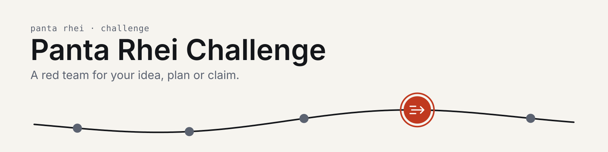
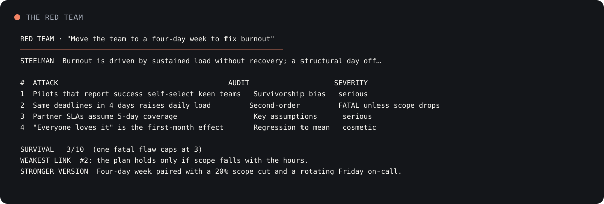
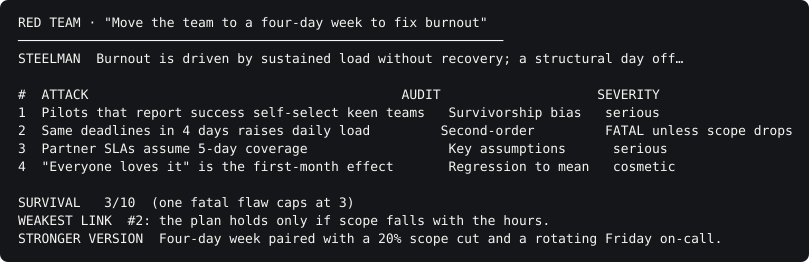

<p align="center"></p>

# Panta Rhei Challenge

A red-team and critical-thinking skill for Claude, Claude Code and Hermes: steelman first, then attack a plan, idea or claim.

<p align="center">
  <a href="#install"></a>
  
  
  
</p>

## What it does

Ask an AI what it thinks of your plan and it will mostly agree. Panta Rhei Challenge steelmans the idea first, then runs four to eight named attacks chosen for what you brought (a plan, a claim, a decision you favour, a judgment about a person) and rebuilds the idea from what survives. You get the stronger version, its weakest link and a survival score where one fatal flaw caps the result.

## Try it

Say any of these after installing:

> Red-team my plan to move the team to a four-day week
> Poke holes in this study claiming remote work cuts productivity by 20%
> I'm sure my co-founder is sabotaging the launch. Challenge that.

## How it works: The Red Team

Every attack names the model behind it and lands or misses. The idea is then rebuilt to survive the attacks that landed, and scored from 0 to 10.

<p align="center"></p>

<p align="center"></p>

1. **Steelman:** the strongest version of the idea, before any attack.
2. **Pick the attack set:** matched to the object, from bias audits to pre-mortems.
3. **Attack:** four to eight, each landing or missing, fewer if one is fatal.
4. **Rebuild:** the stronger version, the weakest link, the survival score.

## Install

**Claude Code**
```
/plugin marketplace add fairyanna85/pantarhei-challenge
/plugin install pantarhei-challenge@pantarhei-challenge
```
Or install the whole family: `/plugin marketplace add fairyanna85/pantarhei`.

**Hermes Agent**
```
hermes skills install https://github.com/fairyanna85/pantarhei-challenge
```

**Claude apps (web, desktop, mobile)**
1. Download [`pantarhei-challenge.zip`](https://github.com/fairyanna85/pantarhei-challenge/releases/latest/download/pantarhei-challenge.zip).
2. Go to **Customize > Skills**, click **+**, then **+ Create skill**, then **Upload a skill**, and choose the ZIP.
3. Turn the skill on. Code execution and file creation must be enabled (Settings > Capabilities).

**Any Agent Skills client** (Codex, Cursor and others): copy `skills/pantarhei-challenge/` into your
client's skills folder.

## What's inside

89 methods of its own, plus 5 shared with sister skills and 56 audit models from the shared library. Every method carries an evidence class and a named failure mode.

### Be fair first

- **Steelman first** — Before criticising, restate the position so well its holder would wish they had said it that way, note points of agreement and what you learned.
- **Principle of charity** — Before judging an ambiguous claim, fixes its interpretation as the version that makes the speaker most reasonable and most of their statements true…
- **Rogerian restatement** — Requires restating the other side's position to their satisfaction and delineating where it is valid before stating one's own, reducing the threat…
- **Ideological Turing test** — Tests claimed understanding of an opposing view by requiring a statement of it good enough that its actual holders cannot distinguish it from one of…
- **Chesterton's fence** — Do not remove a rule or structure until you know why it was put there.
- **Consider the opposite** — Ask how you would evaluate the evidence if it had pointed the other way.

### Anatomy of an argument

- **Toulmin audit** — Dissects an argument into claim, grounds, warrant, backing, qualifier and rebuttal, exposing the unstated warrant that connects evidence to…
- **Argument mapping** — Draws the argument as a tree of contention, reasons, objections and rebuttals so that unsupported premises, single-strand dependence and missing…
- **Fallacy sweep** — Runs the argument against the fallacy canon and names each structurally invalid move: false dichotomy, begging the question, equivocation, slippery…
- **Critical discussion rules (pragma-dialectics)** — Scores a debate against ten rules for resolving a difference of opinion on the merits — freedom, burden of proof, standpoint, relevance, unexpressed…
- **Socratic elenchus** — Tests a definition or claim by drawing out its owner's own admissions, then producing a case the owner accepts that contradicts the definition…
- **Dialectical inquiry** — Build a full counter-plan resting on opposite assumptions and debate the two.

### Evidence and sources

- **Extraordinary claims** — The evidence required scales with how much the claim contradicts what is already well established.
- **Lateral reading** — Judge a source by leaving it: check what other independent sources say about who is behind it, before reading it closely.
- **SIFT check** — Runs four fast moves on an online claim: Stop, Investigate the source, Find better coverage, and Trace claims, quotes and media back to their…
- **Historical source criticism (provenance audit)** — Subjects a document or dataset to external criticism before content is weighed — authenticity, date, authorship, chain of transmission — then…
- **Baloney detection kit (full)** — Runs Sagan's full nine-tool kit: independent confirmation of facts, substantive debate on all sides, no reliance on chains of authority, spin…
- **Quality of Information Check** — Grades each load-bearing source for reliability, completeness and independence before the argument built on it is trusted.
- **Estimative language check (Kent's yardstick)** — Forces every probability word in a claim ('likely', 'serious possibility') onto an agreed numerical range, exposing how much of the apparent…
- **ICD 203 tradecraft standards audit** — Scores an argument against nine fixed standards: sourcing, expressed uncertainty, separation of information from assumption and judgment, analysis of…

### Tradecraft

- **Red team** — An independent group adopts the adversary's goals and tries to make the plan fail.
- **Devil's advocate** — One role argues against the proposal.
- **Analysis of competing hypotheses** — List every hypothesis, list the evidence, mark each piece as consistent or inconsistent with each hypothesis.
- **Key assumptions check** — List every assumption the conclusion rests on, rate how well supported each is, and name what would make it false.
- **Linchpin analysis** — Identifies the few drivers of the outcome and the linchpin premises about those drivers that hold the whole conclusion up, then concentrates the…
- **Diagnostic reasoning (diagnosticity check)** — Tests each piece of evidence for diagnosticity — whether it actually discriminates between the rival hypotheses — instead of letting evidence that is…
- **Mirror imaging check** — Tests whether a judgment about another actor simply projects our own values, cost calculus and decision style onto them, so that their behaviour is…
- **Red Hat Analysis** — Rebuilds the situation entirely inside the other actor's worldview — their history, fears, domestic pressures and information — and re-reads their…
- **Deception Detection** — Asks systematically whether the evidence itself may be planted: does the source have motive, opportunity and means to deceive, does the material fit…
- **Misperception audit (Jervis)** — Applies Jervis's documented patterns of misperception — actors see the other side's behaviour as more centralised, deliberate and hostile than it is…
- **Hedgehog audit (Tetlock)** — Tests an expert claim against Tetlock's twenty-year tournament finding: forecasters who organise everything around one big idea (hedgehogs) perform…
- **Structured Self-Critique** — Before anyone else attacks, the author runs their own finished argument against a fixed checklist — evidence gaps, untested assumptions, alternative…
- **Adversarial Collaboration** — Opposing camps stop debating conclusions and jointly design, in advance, the test or evidence-gathering both agree would discriminate between their…
- **Indicators and signposts (Indicators Validator)** — Converts each rival hypothesis into a list of observable indicators that should appear if it is true, then validates the list — would we actually see…
- **What If? Analysis** — Assumes the unlikely or dismissed event has already happened and works backwards to build the most plausible chain by which it occurred, attacking…
- **High Impact / Low Probability Analysis** — Isolates the low-probability, high-impact branch a plan has quietly priced at zero and forces it to be argued on its merits — drivers, indicators…
- **Outside-In Thinking** — Deliberately starts from the broad external forces — demographic, technological, economic, cultural — that the inside view treats as fixed scenery…

### Updating and the state of a field

- **Bayesian updating** — Forces every piece of evidence to be weighed as a likelihood ratio — how much more expected is this observation if the claim is true than if it is…
- **Inference to the best explanation** — Ranks rival explanations of the same evidence by explanatory virtues — scope, simplicity, fit with background knowledge, fruitfulness, and how little…
- **Severe testing (Popper beyond falsification)** — Credits a claim only for surviving tests it would probably have failed if false — risky predictions and severe probes count; confirmations the claim…
- **Paradigm and anomaly audit (Kuhn)** — Asks whether a field's reigning framework is quietly accumulating anomalies it reclassifies as puzzles or noise, and whether the evidence for the…
- **Progressive or degenerating programme (Lakatos)** — Judges a theory or strategy by its trajectory: progressive if its adjustments predict novel facts, degenerating if each fix only patches the latest…
- **Fixation of belief audit (Peirce)** — Classifies how a belief was actually settled — by tenacity (refusing to reconsider), authority (an institution decreed it), the a priori method (it…
- **Mill's collision test (dead dogma)** — Holds that a belief never exposed to its strongest opposition decays into dead dogma held as prejudice — so the audit asks when the view last faced a…
- **Mertonian norms audit (CUDOS)** — Audits the conditions a claim was produced under against science's institutional norms — communalism, universalism, disinterestedness, organised…
- **Pre-commit update triggers** — Before seeing new evidence, state what result would move your estimate and by how much.
- **Find the crux** — Find the single belief which, if it changed, would change your conclusion.

### Noise and debias

- **Noise audit** — Before debating whether a judgment is biased, measure how much identical cases scatter when judged independently — variability is error even when the…
- **Mediating Assessments Protocol (MAP)** — Break one big holistic judgment into a fixed list of independent sub-judgments, score each on evidence before any overall verdict, and let intuition…
- **Reference class forecasting (outside view)** — Forecast from the outcome distribution of a class of comparable past cases instead of from the details of this plan, then adjust only for differences…
- **Calibration training and Brier scoring** — Force forecasts into explicit probabilities, score them against outcomes with a proper scoring rule such as Brier's, and feed the scores back — the…
- **Superforecasting practices (fox-style aggregation)** — Beyond updating: use granular probabilities instead of verbal ones, break questions into parts, aggregate many small models fox-style rather than…
- **Pre-decisional accountability** — Accountability improves thinking only in one configuration: imposed before the decision, to an audience whose views are unknown, who cares about…
- **Decision journal** — Record the decision, the reasoning, the alternatives and the explicit odds at the moment of deciding, so the later review compares the outcome…
- **Checklist** — For known, repeatable failure points, a short explicit checklist catches the errors that expertise and intelligence reliably skip under load.
- **Data/frame audit** — Sensemaking runs in a loop where the current frame decides what counts as data and the data revise the frame — so audit the frame itself: what it…
- **Fermi estimation** — Decompose a claimed quantity into a chain of estimable factors and multiply: a ten-minute order-of-magnitude check that kills a surprising share of…
- **Feynman's first principle (self-deception audit)** — Applies the principle that you must not fool yourself — and you are the easiest person to fool — by demanding the claimant report everything that…
- **Actively open-minded thinking audit** — Scores the thinking itself against AOT standards: possibilities, evidence and goals searched thoroughly and fairly, with counter-evidence sought as…
- **Intellectual humility audit** — Audits the knower rather than the claim: whether confidence tracks actual competence and evidence, limits are owned, and the arguer shows the…

### Decision attacks

- **Ergodicity check (time average vs ensemble average)** — Expected value is an average across parallel cases; a single life, firm or fund lives one trajectory, and for multiplicative outcomes the time…
- **Robust decision making** — Instead of optimising for the best-estimate future, stress-test each option across hundreds of plausible futures, find the cluster of futures where…
- **Scenario planning** — Build a small set of internally consistent, genuinely different futures from predetermined elements and driving uncertainties, then test whether the…
- **Minimax regret** — For each option and each state of the world, compute the regret — the gap between its result and the best result available in that state — and choose…
- **Reversibility and regret minimisation** — Classify the decision: two-way doors (reversible) should be made fast with light process; one-way doors (irreversible) deserve the full red team…
- **Cynefin triage** — Sort the situation before solving it: clear (apply best practice), complicated (analyse), complex (probe, sense, respond — no analysis settles it in…
- **Expected value and decision trees** — Lay the choice out as a tree — decisions, chance nodes with explicit probabilities, outcomes with explicit values — and fold it back to find which…
- **Value of information** — Information is worth paying for only if it could change the decision; the value of resolving an uncertainty is bounded by how much the choice would…
- **Pareto trade-off analysis** — An option is dominated if another option is at least as good on every criterion and better on one; the surviving set (the Pareto frontier) is where…
- **Satisficing and bounded rationality** — Real deciders search until an option clears an aspiration level, then stop; the quality of a decision process is set by the aspiration level and the…
- **Fast-and-frugal heuristics (ecological rationality)** — Simple rules that use few cues (take-the-best, recognition, tallying) can match or beat complex models in the environments they fit; a heuristic is…
- **Recognition-primed decision model** — Experienced deciders under pressure do not compare options; they recognise the situation as a type, retrieve one workable course of action, and…
- **Kelly criterion (bet sizing)** — For a favourable repeated bet there is an optimal fraction of capital to stake — maximising long-run growth — and betting above it destroys growth…
- **Margin of safety** — Because estimates are wrong and the future is uncooperative, only act when the case survives a substantial cushion of error — the gap between price…
- **Optionality, via negativa and the barbell** — Prefer structures with capped downside and open upside (optionality), improve by removing what harms rather than adding what might help (via…
- **Skin in the game (symmetry audit)** — Advice and recommendations are a different object when the recommender shares the downside; hidden asymmetries — upside for the adviser, ruin for the…
- **Goodhart's law** — Any observed statistical regularity tends to collapse once pressure is placed on it for control: a measure turned into a target stops measuring what…
- **Campbell's law** — The more a quantitative indicator is used for decision making, the more it is subject to corruption pressures and the more it corrupts the process it…
- **Cobra effect (perverse incentive)** — A reward offered to reduce a problem can pay people to produce more of it — the bounty breeds the cobras.
- **Opportunity cost** — The true cost of any choice is the best alternative it forecloses; an option that beats doing nothing can still lose to the option it displaces.
- **Survival score** — After the attacks, rate how much of the idea survives on a 0–10 scale, with the rule: one fatal flaw caps the score at 3, regardless of how many…

### Adlerian audits

- **Teleology check (fictional finalism)** — People are pulled by the goal they are moving toward — a largely unconscious, self-invented 'fictional final goal' — more than they are pushed by the…
- **Private logic vs common sense** — Each person reasons from a private logic — self-consistent convictions about self, others and life ('I am…', 'others are…', 'therefore I must…')…
- **Safeguarding tendencies** — When self-esteem is threatened, people protect their inflated self-image with safeguarding manoeuvres — excuses ('yes, but…'), aggression (attacking…
- **Inferiority, compensation and striving for significance** — Feelings of inferiority are universal and fuel a striving for significance; compensation is healthy when it meets the real task and distorted when it…
- **Social interest test (Gemeinschaftsgefühl)** — Adler's criterion of soundness: a solution is healthy if it works on the useful side of life — solving the problem in a way that serves the community…
- **Style of life and early recollections** — By early childhood each person settles a style of life — a consistent pattern of meeting every task the same way — and the stories they tell about…
- **Courage and encouragement test** — For Dreikurs, misbehaviour and giving up are discouragement, not defect: people act as well as they feel they belong and are capable — so a workable…
- **Dreikurs's four mistaken goals (stakeholder audit)** — Behaviour that looks irrational in a group usually pursues belonging by a mistaken route: undue attention, power, revenge, or assumed inadequacy…

### Shared with sister skills

- **Subtraction** — People default to adding when they improve something.
- **Kill criteria** — Before committing, write the conditions and the date at which you will stop.
- **Pre-mortem** — Imagine it is a year later and the decision failed.
- **Weighted criteria** — Name the criteria, weight them before scoring, score each option, sum.
- **Differential diagnosis** — List every condition that could produce the symptoms, then order tests that discriminate between them, starting with the dangerous and the common.

### Audit models (56)

- **Circle of Competence** — Know the areas where your judgment has a track record and where it does not.
- **Second-Order Thinking** — Look past the immediate result to the reactions it triggers: who responds, how, and what follows from their response.
- **Inversion** — Approach the problem backwards: ask what would make it fail, or what you want to avoid, then steer away from that.
- **Occam's Razor** — Between explanations that fit the facts equally well, start with the one that needs the fewest extra assumptions.
- **Hanlon's Razor** — Before concluding someone acted out of malice, check whether carelessness, ignorance or confusion would explain it.
- **Relativity** — What you see depends on where you stand.
- **Self-Preservation** — People and organisations act to protect their own survival, status and position.
- **Sampling** — Conclusions are only as good as the sample behind them.
- **Randomness** — Many outcomes contain a large element of chance.
- **Regression to the Mean** — An extreme result is usually followed by one closer to average, because chance contributed to the extreme.
- **Bubbles** — Prices or enthusiasm can rise far beyond underlying value when people buy because others are buying.
- **Framing** — How a choice is presented changes how people respond to it, even when the facts are the same.
- **Representation** — A representation stands in for something else and always selects and distorts.
- **Bias from Incentives** — People sincerely come to believe what it pays them to believe.
- **Pavlovian Association** — Repeated pairing of a stimulus with an experience makes the stimulus trigger the response on its own.
- **Envy and Jealousy** — People compare their position with others and resent those who have more.
- **Liking/Loving and Disliking/Hating** — We overrate people and things we like and underrate those we dislike, including the evidence they bring.
- **Denial** — When a truth is painful, people avoid seeing it.
- **Availability Heuristic** — We judge how likely something is by how easily examples come to mind.
- **Failure to Account for Base Rates** — Before judging a specific case, start from how often outcomes like it happen in general.
- **Tendency to Stereotype** — Sorting people and things into categories saves effort but erases individual differences.
- **Failure to See False Conjunctions** — A detailed scenario can feel more likely than a broader one that contains it, though it cannot be.
- **Social Proof** — We take others' behaviour as evidence of what is right, especially when unsure.
- **Narrative Instinct** — We understand events as stories with causes, characters and meaning.
- **First-Conclusion Bias** — The first plausible explanation tends to stop the search for others.
- **Overgeneralization from Small Samples** — A few cases can look like a rule.
- **Relative Satisfaction/Misery** — Satisfaction depends on comparison with expectations, past experience and other people more than on absolute conditions.
- **Commitment and Consistency Bias** — Once people commit, publicly or privately, they tend to act consistently with it even when evidence changes.
- **Hindsight Bias** — Once the outcome is known, it seems to have been predictable all along.
- **Sensitivity to Fairness** — People react strongly to treatment they see as unfair, even at a cost to themselves.
- **Overestimate Consistency of Behavior** — We attribute others' behaviour to their personality and underweight the situation they were in.
- **Influence of Stress** — Under stress, people fall back on habits and quick reactions and are more open to bias.
- **Survivorship Bias** — We see the cases that survived and miss those that failed, so lessons drawn from survivors alone can be wrong.
- **Tendency to Want to Do Something** — There is a strong pull to act, especially when watched or under pressure, even when waiting would be better.
- **Confirmation Bias and Falsification** — We notice and seek evidence that supports what we already think.
- **Myside Bias** — People evaluate evidence, generate arguments and test hypotheses asymmetrically in favour of their own prior position — and…
- **Motivated Reasoning** — Reasoning is steered by the conclusion the reasoner wants to reach: congenial evidence is waved through, uncongenial evidence is…
- **Identity-Protective Cognition** — People credit or dismiss evidence to protect their standing in a group they belong to, so on identity-loaded questions more…
- **Bias Blind Spot** — People readily detect bias in others while rating themselves largely immune, because they check their own thinking by…
- **Groupthink** — A cohesive group under a directive leader suppresses dissent, self-censors and manufactures unanimity, producing decisions no…
- **Abilene Paradox** — A group collectively decides on a course of action that most or all members privately oppose, because each wrongly assumes the…
- **Pluralistic Ignorance** — Most members of a group privately reject a norm or claim but publicly conform, because each misreads everyone else's conformity…
- **Anchoring** — Numerical judgments are pulled toward the first number on the table — even an arbitrary or admitted-irrelevant one — and adjust…
- **WYSIATI (What You See Is All There Is)** — Judgment builds the most coherent story possible from the evidence currently visible and does not spontaneously ask what evidence…
- **Planning Fallacy** — Plans forecast the best case: timelines and budgets are built from the inside view of this project and systematically ignore how…
- **Overconfidence** — Stated confidence systematically exceeds accuracy — events claimed to be certain fail at rates no one in the room would accept if…
- **Affect Heuristic** — Risk and benefit are read off one feeling: liked things are judged low-risk and high-benefit, disliked things the reverse…
- **Sunk Cost** — Money, time and effort already spent — which no decision can recover — keep pulling investment into failing courses of action to…
- **Status Quo Bias** — Options are preferred because they are the current arrangement, beyond what their merits justify — the default wins by being the…
- **Authority Bias** — Claims gain credence from the rank, title or confidence of the person stating them, independently of the evidence offered.
- **Halo Effect** — One salient trait — success, attractiveness, a famous employer — bleeds into ratings of every other trait, so independent…
- **Fundamental Attribution Error** — Others' behaviour is explained by their character while the pressures of their situation are discounted — so failures get blamed…
- **Self-Serving Bias** — Success is attributed to one's own skill and failure to circumstances — in oneself and one's team — corrupting every…
- **Negativity Bias** — Bad events, bad feedback and bad possibilities weigh more than equivalent good ones, so a single vivid downside can veto a…
- **Optimism Bias** — People systematically overestimate the likelihood of good outcomes for themselves specifically — their project, their health…
- **Dunning–Kruger Effect** — The skills needed to produce a correct answer are the same skills needed to recognise one, so the least competent judges are the…

## How honest is it?

Every method carries an evidence class (`formal`, `empirical`, `heuristic`, `analogical`) and its
origin, and the skill caps its claims by them. Practitioner methods are labelled as such.
Challenge only corrects distortion; it never supplies an answer of its own. A survived attack is not evidence the idea is right.

## The Panta Rhei pack (optional)

Each module works on its own. The pack installs all five plus Panta Rhei, the hub that runs them
end to end.

| | Module | For |
|---|---|---|
| 🔵 | [Panta Rhei Reframe](https://github.com/fairyanna85/pantarhei-reframe) | Working out what the real problem is |
| 🟣 | [Panta Rhei Brainstorm](https://github.com/fairyanna85/pantarhei-brainstorm) | Brainstorming and idea generation |
| 🟢 | [Panta Rhei Solve](https://github.com/fairyanna85/pantarhei-solve) | Structuring and diagnosing problems |
| 🔴 | [Panta Rhei Challenge](https://github.com/fairyanna85/pantarhei-challenge) | Red-teaming ideas and claims |
| 🟡 | [Panta Rhei Decide](https://github.com/fairyanna85/pantarhei-decide) | Making the call |
| ⚫ | [Panta Rhei](https://github.com/fairyanna85/pantarhei) | The pack: all five, end to end |

## Credits and license

Methods are credited to their originators in `catalog.json` and on every card; all descriptions are
our own wording. Code: MIT. Method text: CC BY 4.0. Propose a method: see [CONTRIBUTING.md](CONTRIBUTING.md).
